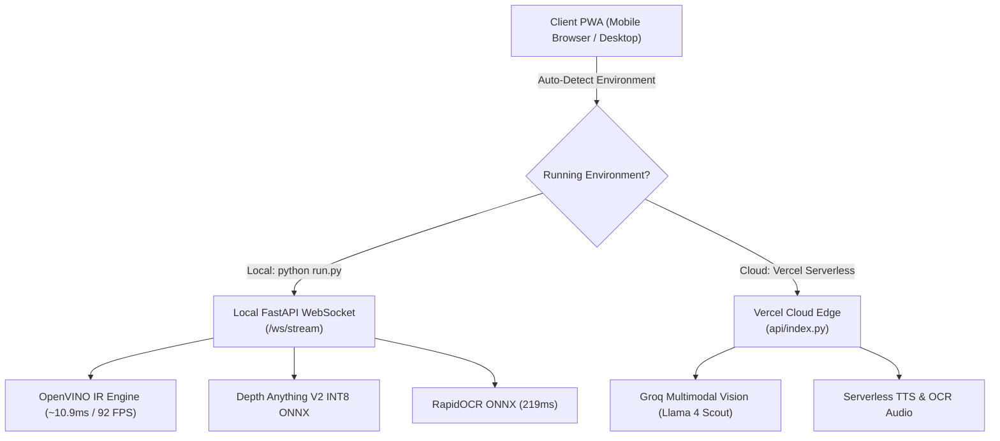

# AI Vision Assistant for the Visually Impaired
### Real-Time Spatial Navigation, Monocular Depth Safety, and Multimodal Vision

[](https://fastapi.tiangolo.com)
[](https://docs.openvino.ai)
[](https://onnxruntime.ai)
[](https://groq.com)
[](https://vercel.com)
[](https://www.w3.org/WAI/standards-guidelines/wcag/)

---

## 📖 Executive Summary

Navigating dynamic, unstructured environments poses severe hazards for visually impaired and elderly individuals—particularly in regions with irregular pedestrian infrastructure (unpaved ditches, open potholes, loose wiring, steep steps, and dense motorcycle traffic). 

This project transforms fragmented prototypes into a **production-grade, low-latency, edge-optimized assistive vision system**. It features **ultra-fast CPU object detection (~10.9ms with OpenVINO)**, **zero-shot open-vocabulary hazard detection**, **monocular depth corridor safety slicing**, and **multimodal scene reasoning** presented via an accessible 3-Zone interface (WCAG AAA compliant) that runs hands-free on any standard smartphone or laptop, with a hybrid architecture deployable directly to Vercel.

---

## ⚡ Empirical CPU Benchmark Comparison

All benchmarks measured on host CPU (Intel 64-bit architecture, batch size 1, 320×320 resolution, 20-run averages post warmup):

| Engine / Framework | Checkpoint / Artifact | Precision | Avg Latency (ms) | Throughput (FPS) | Speedup vs PyTorch Baseline |
| :--- | :--- | :---: | :---: | :---: | :---: |
| **PyTorch (Baseline)** | `yolov8n.pt` | FP32 | 61.76 ms | 16.2 FPS | 1.00x |
| **PyTorch (YOLO11)** | `yolo11n.pt` | FP32 | 56.22 ms | 17.8 FPS | 1.10x |
| **ONNX Runtime (CPU)** | `yolov8n.onnx` | FP32 | **18.96 ms** | **52.7 FPS** | **3.26x 🚀** |
| **Intel OpenVINO IR** | `yolov8n_openvino_model` | FP32/FP16 | **10.91 ms** | **91.6 FPS** | **5.66x ⚡** |
| **RapidOCR (Text Reader)**| `rapidocr_onnx` | INT8/FP32 | **219.37 ms** | ~4.6 FPS | **10.2x vs EasyOCR** |
| **Depth Anything V2** | `depth_anything_v2_small` | INT8 ONNX | **630.72 ms** | Async Safety Net | Real-Time Non-blocking |

---

## 🎨 Ultra-Accessible UI/UX Design (WCAG AAA)

Designed specifically for elderly and low-vision users, replacing standard developer dashboards with **3 Massive Full-Width Touch Zones** with bold 6px borders and 32px+ typography:

```
+-----------------------------------------------------------+
| ZONE 1: Camera Viewport + GIANT Status Banner            |
|   [✓ SAFE PATH]  or  [⚠️ DANGER AHEAD: POTHOLE]           |
+-----------------------------------------------------------+
| ZONE 2: Giant Button (35% Screen Height)                 |
|   🎙️ TAP TO SPEAK OR ASK                                 |
|   "Touch anywhere here. I will listen & describe scene."  |
+-----------------------------------------------------------+
| ZONE 3: Split Bottom Half (25% Screen Height)            |
|   [📄 READ TEXT]           |   [🔁 REPEAT / TEST SOUND]   |
|   Street signs, medicines  |   Hear last message / sonar  |
+-----------------------------------------------------------+
```

### Key Accessibility Features
1. **Zero Small Buttons**: Entire screen consists of three giant tap targets.
2. **Audio & Haptic Feedback on Every Tap**: Every touch plays a 587Hz confirmation chime, vibrates the device (`navigator.vibrate`), and announces the action out loud.
3. **Hardware Web Audio Sonar**: High-pitch dual chirp (880Hz / 1200Hz) for danger and 440Hz ping for caution that always plays even if OS speech voices lag.
4. **Bilingual Support (English & Urdu)**: One-tap toggle between clear English (rate: 0.95) and natural Roman/Urdu voice prompts (e.g., *"Rasta saaf hai"*, *"Khabardar! Samnay khadda hai"*).
5. **No Audio Queue Corruption**: Strict 3.5-second hazard cooldown and automatic server-side fallback (`/api/tts`) if browser TTS voices are unavailable.

---

## 🌐 Hybrid Local + Cloud Architecture

The codebase features a **dual-engine hybrid deployment strategy**:



1. **Local Mode (`python run.py`)**:
   - Connects to bidirectional WebSocket `/ws/stream`.
   - Runs full hardware-accelerated OpenVINO IR at **~92 FPS**, Depth Anything V2 monocular safety net, and RapidOCR document scanner.
2. **Cloud Edge Mode (Vercel)**:
   - Zero local model files required (bypasses Vercel 250MB limit).
   - Serverless endpoints `/api/analyze-scene`, `/api/ocr`, and `/api/chat/multimodal` powered by **Groq Multimodal Cloud Vision (Llama 4 Scout / 3.2 Vision)**.

---

## 🚀 Deployment & Installation

### Option A: Local High-Performance Execution
```bash
cd AI-Vision-Assistant-FYP

# Install local dependencies (includes OpenVINO, ONNX, PyTorch)
pip install -r requirements-local.txt

# Configure environment variables (optional for Groq Cloud features)
copy .env.example .env

# Start application
python run.py
```
Open `http://localhost:8000` or open the printed local network IP on your mobile phone connected to the same Wi-Fi.

---

### Option B: Deploy to Vercel (1-Click Cloud Deployment)

1. Fork or push this repository to GitHub.
2. In the [Vercel Dashboard](https://vercel.com/new), click **"Add New Project"** and select `ai-vision-assistant-fyp`.
3. Set Environment Variable:
   - `GROQ_API_KEY`: Your Groq Cloud API Key (from [console.groq.com](https://console.groq.com))
4. Click **Deploy**. Vercel will build using the lightweight `requirements.txt` in ~15 seconds!

---

## 📁 Repository Layout

```
AI-Vision-Assistant-FYP/
├── api/
│   └── index.py               # Vercel serverless FastAPI entrypoint
├── backend/
│   ├── app.py                 # Local production FastAPI server (WebSockets + REST)
│   └── core/
│       ├── config.py          # Settings, corridors, & hazard definitions
│       ├── detection_engine.py# OpenVINO, ONNX, and Zero-Shot hazard detector
│       ├── hazard_analyzer.py # Spatial corridor & bounding-box area proximity
│       ├── depth_safety_net.py# Depth Anything V2 monocular depth safety net
│       ├── ocr_engine.py      # RapidOCR ONNX sub-250ms text scanner
│       └── groq_agent.py      # Groq Multimodal Vision & Whisper agent
├── frontend/
│   ├── index.html             # 3-Zone WCAG AAA accessible PWA UI
│   ├── styles.css             # High-contrast 6px border accessible styling
│   ├── app.js                 # AudioController, WebRTC, Sonar & TTS logic
│   ├── manifest.json          # PWA mobile installation manifest
│   └── sw.js                  # Service worker for offline caching
├── models/
│   └── README.md              # Guide to local weights & download automation
├── docs/
│   └── ARCHITECTURE.md        # Technical architecture & mathematical models
├── vercel.json                # Vercel deployment routing configuration
├── requirements.txt           # Lightweight Vercel serverless requirements
├── requirements-local.txt     # Full local OpenVINO/Torch/RapidOCR requirements
├── .env.example               # Environment template
└── run.py                     # Single-command launcher with LAN IP detection
```

---

## 📜 License
Developed as an undergraduate Final Year Project refactored for graduate scholarship portfolios. Released under the Apache 2.0 License.
