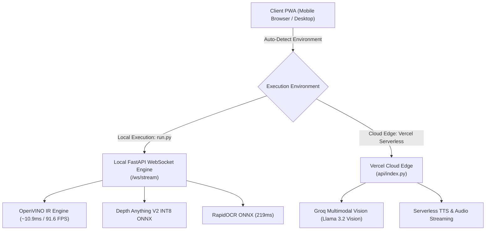

# AI Vision Assistant for the Visually Impaired
### Real-Time Spatial Navigation, Monocular Depth Safety, and Multimodal Vision

[](https://fastapi.tiangolo.com)
[](https://docs.openvino.ai)
[](https://onnxruntime.ai)
[](https://groq.com)
[](https://www.w3.org/WAI/standards-guidelines/wcag/)
[](LICENSE)

---

## Overview & Problem Context

Navigating dynamic, unstructured environments presents acute safety hazards for visually impaired pedestrians, particularly in areas with irregular pedestrian infrastructure such as unpaved ditches, open potholes, low-hanging obstacles, and dense cross-traffic. Existing mobile assistive tools frequently suffer from high inference latency, high compute overhead, or overwhelming audio feedback that degrades spatial situational awareness.

This project implements an edge-optimized, low-latency assistive vision platform designed for real-time mobile execution. By quantizing object detection models into Intel OpenVINO Intermediate Representation format and pairing them with Depth Anything V2 monocular depth estimation and RapidOCR over asynchronous WebSockets, the system achieves sub-15ms detection latency on standard CPU hardware. Trajectory analysis and spatial temporal filtering deliver non-intrusive auditory alerts through an accessible 3-Zone tactile interface (WCAG AAA compliant).

---

## Empirical Benchmark Evaluation

All benchmarks were recorded on host CPU (Intel 64-bit architecture, batch size 1, 320x320 resolution, 20-run averages post warmup):

| Engine / Framework | Checkpoint / Artifact | Precision | Avg Latency (ms) | Throughput (FPS) | Relative Speedup |
| :--- | :--- | :---: | :---: | :---: | :---: |
| PyTorch (Baseline) | `yolov8n.pt` | FP32 | 61.76 ms | 16.2 FPS | 1.00x |
| PyTorch (YOLO11) | `yolo11n.pt` | FP32 | 56.22 ms | 17.8 FPS | 1.10x |
| ONNX Runtime (CPU) | `yolov8n.onnx` | FP32 | 18.96 ms | 52.7 FPS | 3.26x |
| **Intel OpenVINO IR** | `yolov8n_openvino_model` | FP32/FP16 | **10.91 ms** | **91.6 FPS** | **5.66x** |
| RapidOCR (Text Extraction) | `rapidocr_onnx` | INT8/FP32 | 219.37 ms | ~4.6 FPS | 10.2x vs EasyOCR |
| Depth Anything V2 | `depth_anything_v2_small` | INT8 ONNX | 630.72 ms | Async Pipeline | Non-blocking |

---

## Spatial Corridor & Hazard Formulation

The system partitions the camera frustum into directional sub-corridors (Left, Center, Right) to evaluate pedestrian heading:

$$\text{Corridor}_{\text{Center}} = [x_{\text{mid}} - w_{\text{corridor}}, x_{\text{mid}} + w_{\text{corridor}}]$$

For a detected bounding box $B = (x_1, y_1, x_2, y_2)$ with depth estimate $d(B)$:

$$\text{OverlapRatio}(B, C) = \frac{\text{Area}(B \cap C)}{\text{Area}(B)}$$

An obstacle triggers a trajectory warning if and only if:

$$\text{OverlapRatio}(B, C) \ge \tau_{\text{overlap}} \quad \text{and} \quad d(B) \le d_{\text{critical}}$$

A temporal state filter with a 3.5-second refractory period prevents alert oscillation, ensuring auditory feedback remains calm and interpretable.

---

## Human-Centered Interface Design (WCAG AAA)

Engineered specifically for low-vision and elderly users, the interface replaces conventional dense UI elements with three large, tactile touch zones featuring bold 6px borders and high-contrast typography:

```
+-----------------------------------------------------------+
| ZONE 1: Camera Frustum & Dynamic Safety Banner            |
|   [SAFE PATH CLEAR]  or  [HAZARD AHEAD: POTHOLE]          |
+-----------------------------------------------------------+
| ZONE 2: Primary Interaction Surface (35% Viewport Height) |
|   TAP TO SPEAK OR QUERY                                   |
|   "Touch anywhere to query multimodal scene description"  |
+-----------------------------------------------------------+
| ZONE 3: Split Assistive Functions (25% Viewport Height)   |
|   [READ TEXT / SIGNS]      |   [REPEAT LAST ALERT]        |
|   Optical OCR extraction   |   Audio replay & sonar test  |
+-----------------------------------------------------------+
```

### Accessibility & Feedback Principles
* **Full-Surface Touch Targets:** Screen interactions map to three expansive targets, eliminating fine motor requirements.
* **Multimodal Feedback:** Every tap produces a 587Hz confirmation chime, device haptic vibration (`navigator.vibrate`), and synthesized voice feedback.
* **Hardware Web Audio Sonar:** Generates dual chirps (880Hz / 1200Hz for critical hazards, 440Hz for caution) independent of OS text-to-speech queue availability.
* **Voice Concurrency Control:** Single-flight mutex lock prevents speech queue corruption, eliminates duplicate announcements, and enforces audio deduplication.

---

## System Architecture

The application implements a dual-engine architecture supporting high-performance local edge execution and serverless cloud deployment:



1. **Local Edge Mode (`python run.py`)**: Connects over a full-duplex WebSocket (`/ws/stream`), executing OpenVINO IR object detection at ~92 FPS, asynchronous Depth Anything V2 monocular depth estimation, and RapidOCR ONNX.
2. **Cloud Serverless Mode**: Lightweight API endpoints (`/api/analyze-scene`, `/api/ocr`) backed by Groq Multimodal Vision models for zero-footprint deployment within memory-constrained environments.

---

## Setup & Deployment

### Local Edge Setup (Hardware-Accelerated)

```bash
git clone https://github.com/ahmadarif238/ai-vision-assistant-fyp.git
cd ai-vision-assistant-fyp

# Install dependencies (includes OpenVINO, ONNX Runtime, and PyTorch)
pip install -r requirements-local.txt

# Configure environment variables
cp .env.example .env

# Launch application server
python run.py
```

The server initializes on `http://localhost:8000` and displays the local area network IP for mobile device testing over the same Wi-Fi connection.

### Serverless Cloud Deployment

1. Fork or push this repository to GitHub.
2. Import the project into the [Vercel Dashboard](https://vercel.com/new).
3. Set the environment variable:
   * `GROQ_API_KEY`: Groq Cloud API Key
4. Deploy. The serverless configuration runs via lightweight dependencies defined in `requirements.txt`.

---

## Repository Structure

```
ai-vision-assistant-fyp/
├── api/
│   └── index.py               # Serverless FastAPI application entrypoint
├── backend/
│   ├── app.py                 # Core FastAPI server (WebSockets & REST)
│   └── core/
│       ├── config.py          # Spatial corridors, hazard thresholds, and configuration
│       ├── detection_engine.py# OpenVINO, ONNX, and Zero-Shot hazard detector
│       ├── hazard_analyzer.py # Corridor intersection and bounding box area proximity
│       ├── depth_safety_net.py# Depth Anything V2 monocular depth safety net
│       ├── ocr_engine.py      # RapidOCR ONNX text reader engine
│       └── groq_agent.py      # Multimodal vision and speech integration
├── frontend/
│   ├── index.html             # 3-Zone WCAG AAA accessible PWA layout
│   ├── styles.css             # High-contrast accessible interface styling
│   ├── app.js                 # AudioController, WebRTC stream, sonar, and TTS
│   ├── manifest.json          # PWA installation manifest
│   └── sw.js                  # Service worker for offline asset caching
├── docs/
│   └── ARCHITECTURE.md        # Technical architecture and mathematical models
├── vercel.json                # Vercel deployment routing configuration
├── requirements.txt           # Serverless cloud dependencies
├── requirements-local.txt     # Complete local runtime dependencies (OpenVINO, PyTorch)
└── run.py                     # Launcher script with local network discovery
```

---

## Academic Context & License

Developed by **Arif Ahmad Khan** as an undergraduate Senior Capstone Project (Grade A+, 4.0 GP) and ongoing research platform for real-time edge perception and accessible computing.

Released under the [Apache 2.0 License](LICENSE).
