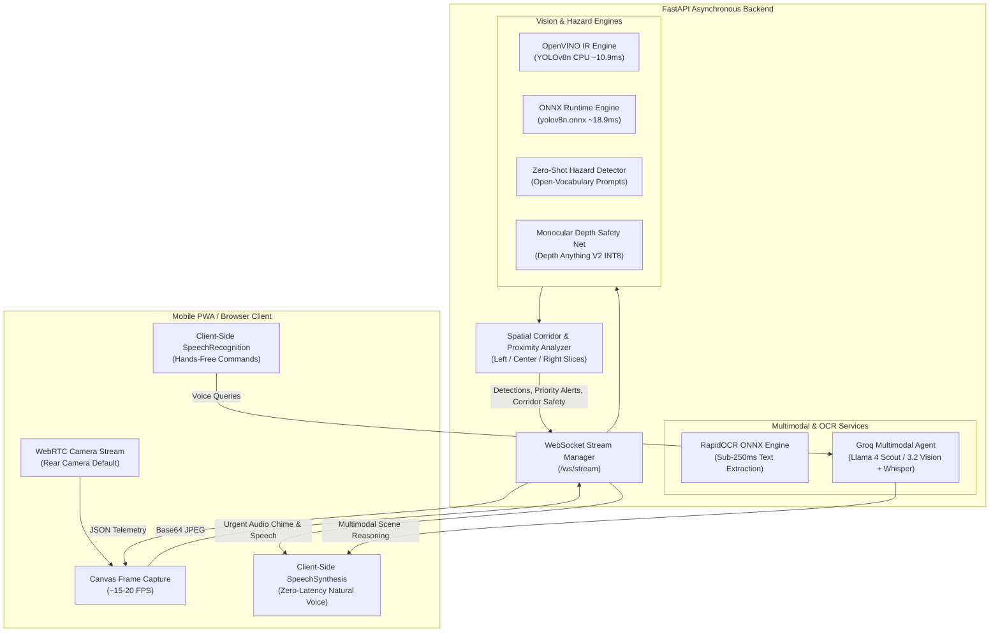

# System Architecture: AI Vision Assistant 2026

## 1. System Overview

The **AI Vision Assistant** is a real-time, low-latency, edge-optimized assistive vision system designed for visually impaired and low-vision individuals. It bridges the gap between high-frequency spatial obstacle avoidance and high-level multimodal conversational reasoning.

---

## 2. Mathematical Formulations

### 2.1 Spatial Corridor Slicing
Given a video frame of width $W$ and height $H$, the field of view is segmented into three directional corridors:
$$\text{Corridor}(c_x) = \begin{cases} 
\text{Left}, & 0 \le c_x < \frac{1}{3}W \\ 
\text{Center}, & \frac{1}{3}W \le c_x \le \frac{2}{3}W \\ 
\text{Right}, & \frac{2}{3}W < c_x \le W 
\end{cases}$$
where $c_x = \frac{x_1 + x_2}{2}$ is the horizontal centroid of bounding box $B = [x_1, y_1, x_2, y_2]$.

### 2.2 Bounding Box Area Proximity Ratio
Rather than relying on uncalibrated monocular width alone, distance proximity is quantified via the normalized bounding box area ratio:
$$\Phi(B) = \frac{(x_2 - x_1) \cdot (y_2 - y_1)}{W \cdot H}$$

Proximity thresholds are defined as:
$$\text{Proximity}(\Phi) = \begin{cases} 
\text{Critical (Immediate Alert)}, & \Phi \ge 0.16 \\ 
\text{Approaching (Warning)}, & 0.07 \le \Phi < 0.16 \\ 
\text{Nearby}, & 0.02 \le \Phi < 0.07 \\ 
\text{Distant}, & \Phi < 0.02 
\end{cases}$$

### 2.3 Monocular Depth Safety Net (Drop-Off & Void Detection)
To detect unlabelled hazards (e.g., potholes, open manholes, steep drop-offs, construction ditches), the depth map $D(x, y) \in [0, 1]$ produced by Depth Anything V2 is evaluated across the ground zone ($y \in [0.75H, H]$):

$$\mu_{\text{ground}} = \frac{1}{|G_c|} \sum_{(x, y) \in G_c} D(x, y)$$

If $\mu_{\text{ground}} < \tau_{\text{drop-off}}$ (where $\tau_{\text{drop-off}} = 0.20$), a sudden depth discontinuity (void) is identified, immediately raising an acoustic drop-off alarm.

---

## 3. Asynchronous Decoupling & Concurrency Design

Legacy prototypes failed because synchronous `pyttsx3` and `speech_recognition` calls blocked the main Python execution thread, dropping video frame-rates to 1-2 FPS. 

The 2026 architecture introduces three layers of decoupling:
1. **Asynchronous I/O Layer**: Built on FastAPI and WebSockets with an async event loop (`asyncio`).
2. **CPU Inference ThreadPool**: Heavy matrix operations (OpenVINO IR, ONNX Runtime, and Depth Anything) execute in dedicated background worker threads (`ThreadPoolExecutor`).
3. **Client-Side Speech Processing**: Text-to-Speech (TTS) and Speech-to-Text (STT) are offloaded to client browser hardware via Web Speech API (`SpeechSynthesis` and `webkitSpeechRecognition`), ensuring zero network audio latency and complete audio-video decoupling.

